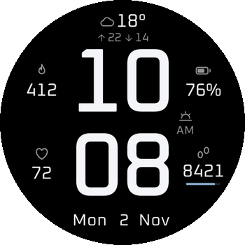

# Big & Clear: Amazfit watch face

<p align="center">
  
</p>

**Glance at your wrist. Read the time from across the room. Watch the battery barely move.**

Big & Clear is a round face for Zepp OS 3.0+:

- **466×466:** GTR 4, Active 2 Round, Cheetah 2 Pro, T-Rex 3 Pro 44
- **480×480:** Balance family, Cheetah Pro

The layout comes from `amazfit-face-round-v2.html`.

## Why the battery lasts

- **No timers.** The face uses OS-redrawn widgets only. It has no `setInterval` or `setTimeout`.
- **One callback.** After `build()`, the only JS switches steps to a `10.4K` style at 10,000+. The value rounds down, so it never reads high.
- **The OS does the sensing.** Heart rate, steps, calories, battery, and weather use `data_type` bindings. The face never starts its own sampling.
- **No font engine.** The background is pure black, and Oxanium glyphs ship as pre-rendered PNG sprites.
- **Always-on display:** Dim outline time, date, and battery. Weather, calories, heart rate, and steps stay hidden. No burn-in shift, since that would need a wake-up each minute.
- **Sleep:** Zepp turns on Do Not Disturb. Black `IMG_STATUS` (DISTURB) overlays hide every data slot and dim the time to about 70%.

## What you see

- Stacked hour and minute time, with AM/PM tag
- Weather icon, temperature, and high/low
- Date, calories, battery, heart rate
- Steps with a goal bar

The battery icon fills to the nearest quarter (100, 75, 50, 25, or 0%) and turns amber below 20%. The number always shows the exact value.

## Make it yours

Long-press the face, then select **Edit**:

- **Time style:** solid or outline
- **Weather:** with high/low, temperature only, or off
- **Date, calories, battery, heart rate, steps:** on or off, one at a time

The time format follows your phone's system setting.

## Build it

```
python3 tools/gen_assets.py   # regenerate sprites + layouts (needs fonttools, Pillow, numpy, librsvg)
zeus build                    # writes dist/*.zab
zeus preview                  # or install through the Zepp app in developer mode
```

Previews land in `docs/`. Oxanium is under the SIL OFL (`tools/fonts/OFL-Oxanium.txt`).

## Help verify it

No simulator or watch was available, so only `zeus build` and the preview renders were checked. Test these on a device:

- **Weather icons:** The mapping uses Zepp condition IDs 0-28 (`WEATHER_MAP` in the generator).
- **Battery fill:** `IMG_LEVEL` must pick image `floor(percent × 40 / 100)`. If the OS rounds differently, the fill can be off by a quarter near thresholds.
- **10K+ steps:** `IMG` widgets must accept `setProperty(prop.MORE, { src, x, w, h })`. The `Step` sensor also needs `data:user.hd.step`, which `app.json` already declares.
- **Do Not Disturb:** The overlay works only if your watch enables DND during sleep.
- **Step goal bar:** `IMG_LEVEL` with `type: STEP` must scale to your goal.
- **Titles:** Edit-mode option titles exist only in English, Simplified Chinese, and Traditional Chinese.

**Install it, then break it.** Open an issue with your watch model and the test that failed. One real-device result beats any amount of review.
